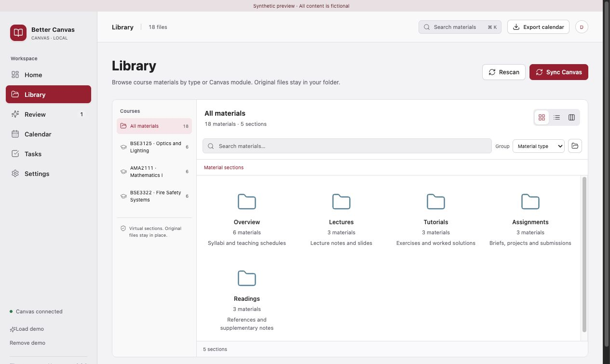
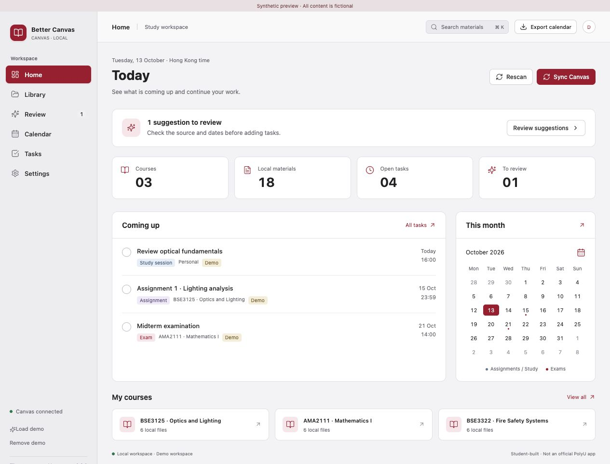

# PolyU Better Canvas

A local study workspace for PolyU Canvas on **Apple Silicon Macs running macOS 13 or later**. Download course materials, organize them into useful sections, review AI suggestions, and manage tasks and your calendar.

**Version 0.2.0 · Desktop prototype.** Student-built; not an official PolyU application.

## Library

The library organizes materials into **Overview, Lectures, Tutorials, Assignments, Exams, Labs, Readings, Pages, and Unsorted**. Classification uses filenames and source folders; you can override it in the inspector. Unknown files remain Unsorted.

- **Material type** groups lecture slides, tutorials, assignment briefs and other resources into separate sections.
- **Canvas module** preserves source module folders for browsing course structure.
- **Icons, List, and Columns** offer Finder-style navigation. The app remembers your view preference.
- Mac file icons come from the system. Selecting a file opens its text and source information in the inspector.
- Canvas IDs are hidden from displayed download filenames. Original filenames and paths remain available in the inspector.
- Sections are virtual. Classification does not move, rename, or duplicate your files.



## Other features

- **Canvas:** sign in through a dedicated school WebKit window, including MFA. Sync course files, module attachments, pages and assignment dates. Check manually or once an hour while the app is open.
- **Documents:** local text extraction and page references for PDFs; Vision OCR for scanned pages. TXT, Markdown and HTML are also supported.
- **Your AI:** OpenAI-compatible endpoints, Anthropic and local Ollama. Select a document and approve sending extracted text before calling a provider.
- **Review:** inspect source excerpts and dates before accepting suggestions. Unknown dates, week numbers and conflicts remain unresolved.
- **Tasks and Calendar:** dated or undated tasks, completion states, month view and a monthly agenda. Export confirmed, dated, incomplete items as ICS.
- **Demo:** load and remove synthetic materials without connecting an account.

The interface, built-in messages, native helper dialogs, and AI instructions are in English. Course content and user-authored text retain their original language.



## Install and use

Open the built `.dmg`, drag **PolyU Better Canvas** into Applications, and launch it. The packaged app does not require Node, Rust, Python or Chrome.

1. Choose an existing course folder or create the default library.
2. Connect Canvas and complete school sign-in and MFA, then click **Sync Canvas**.
3. Browse a course and open a material section. Select a file to preview its text or adjust its material type.
4. Optionally configure your AI provider in Settings and approve analyzing a selected document.
5. Review extracted suggestions before adding them to Tasks and Calendar.
6. Export an ICS file and import it using your calendar application.

Without an AI key, you can use local date rules and manual tasks. A chat subscription may not include API access.

This prototype is ad-hoc signed and not notarized. macOS may ask you to allow the app in Privacy & Security on first launch. Public distribution will require Developer ID signing and notarization. See the [user guide](docs/user-guide.md).

## Data and privacy

| Data | Location |
| --- | --- |
| New default library | `~/Documents/PolyU Better Canvas/Local/` or a folder you choose |
| Index, tasks, settings and cache | `~/Library/Application Support/local.polyu.canvas.localized/` |
| Canvas session and AI keys | macOS Keychain, service `local.polyu.canvas.localized.v1` |

The internal app identifier, Keychain service and existing calendar UIDs stay stable across the project rename so upgrades preserve accounts, tasks and calendar identities. Existing library folders remain where you chose them.

Downloaded files are tracked by Canvas IDs and hashes. Remote updates preserve locally edited copies and save the newer version separately. Automatic sync does not restore files you deleted locally; Settings provides an explicit restore action.

Different Canvas accounts use separate workspaces. Signing out stops collection and clears that session and reading cache, while keeping downloaded files and study plans. Closing the app stops scheduled checks; no persistent background service is installed.

Cloud AI receives only text you explicitly approve, up to 60,000 characters. Canvas credentials are not sent to AI. Course files, credentials, databases and build outputs are excluded from Git.

## Development

Requires an Apple Silicon Mac, Node.js, Rust stable and Xcode Command Line Tools.

```sh
npm ci
npm run desktop
```

To preview the interface with fictional data:

```sh
npm run dev
```

Open `http://127.0.0.1:1420/?preview=1`. Synthetic preview mode is limited to development browsers; it cannot sync Canvas, change files, or call AI.

```sh
npm run bundle
```

Native helpers and icons are generated automatically. Outputs:

- App: `src-tauri/target/release/bundle/macos/PolyU Better Canvas.app`
- DMG: `src-tauri/target/release/bundle/dmg/`

| Directory | Responsibility |
| --- | --- |
| `src/` | React interface and library navigation |
| `src-tauri/src/` | Rust core, SQLite index, classification, Canvas, AI and ICS |
| `src-tauri/native/` | Swift school sign-in, Keychain, system file icons, PDFKit and Vision |
| `scripts/` | Native build and synthetic acceptance checks |

The packaged app uses Tauri commands/events and private versioned JSON pipes, without a local HTTP service. UI conventions are documented in [DESIGN.md](DESIGN.md).

## Checks and limitations

```sh
npm run build
cargo test --manifest-path src-tauri/Cargo.toml
npm run native
python3 scripts/test-native.py
python3 scripts/test-keychain.py
```

Tests use synthetic documents and mock AI providers. Keychain checks use an isolated temporary test keychain.

Real PolyU sign-in and an initial course sync were verified in the preceding prototype. Some sources were unreadable; per-source failure details still need work. See the [validation record](docs/validation.md).

Real syllabus AI accuracy and external calendar import still require acceptance testing. Apple Calendar/Reminders native writing, cross-device sync, direct Office parsing, video downloading, grades, Windows and Intel Mac support are deferred. Repeated ICS import behavior depends on the receiving calendar app.

## Attribution and licensing

Native sign-in and document reading were adapted from [PolyU Study Console](https://github.com/Andre-HUANG/polyu-study-console) with the author's permission, as confirmed by this project's owner. See [NOTICE.md](NOTICE.md) for sources and scope. Borrowed implementation is not automatically relicensed as MIT; original work follows [LICENSE](LICENSE). Third-party dependencies retain their own licenses and notices.
